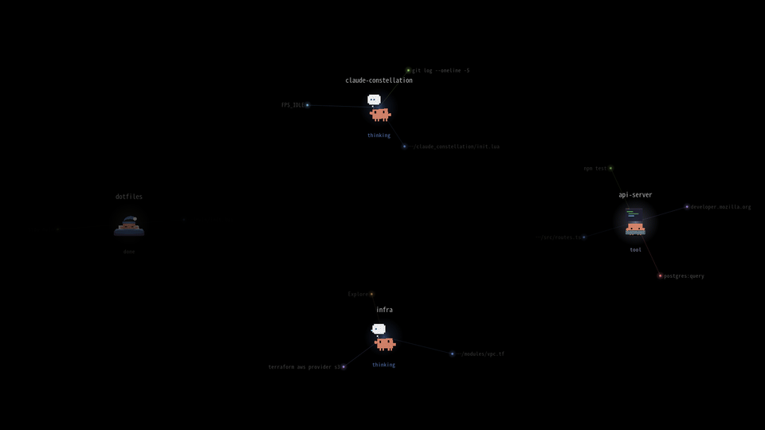
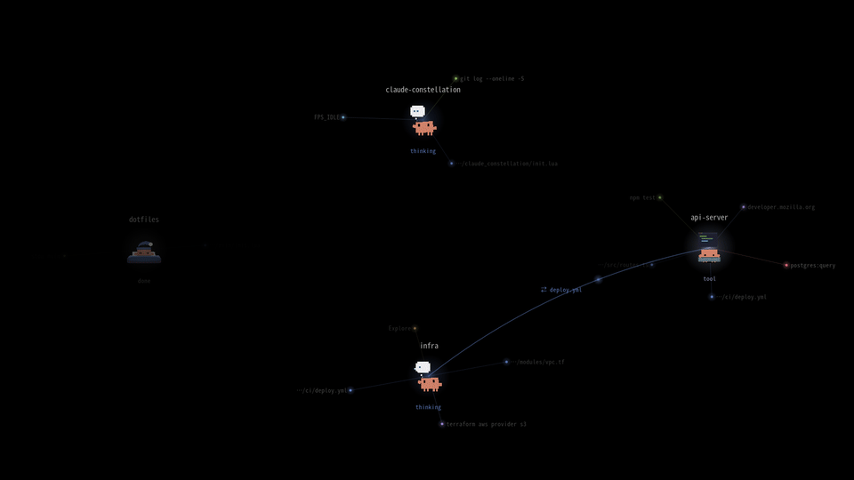
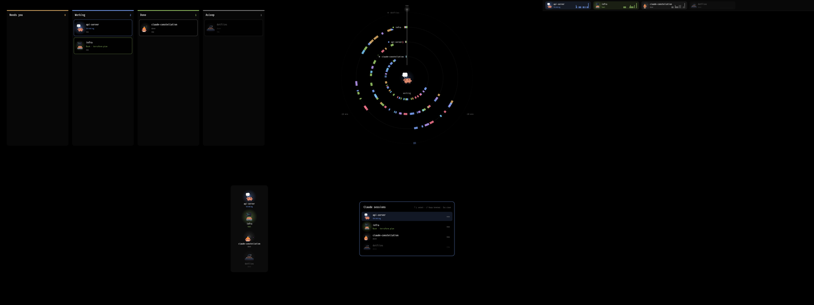
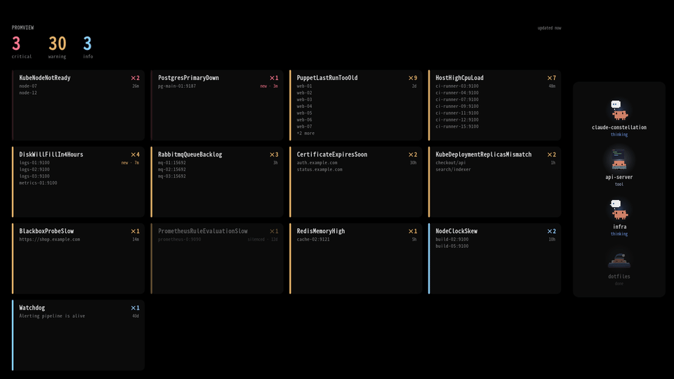
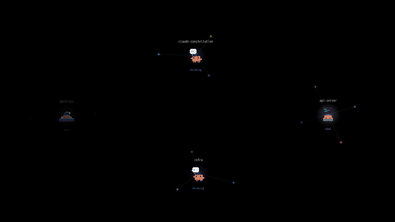
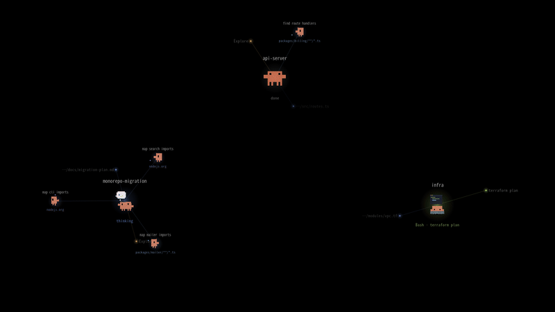

# claude-constellation

Animated wallpaper for AwesomeWM: every active Claude Code session shows up as a glowing node. The resources it works with (files, shell commands, searches, web, MCP servers, subagents) orbit around it.



- **Node**: pulses with the session state. Accent blue for `thinking`, the tool kind's colour for `tool`, blinking yellow for a pending permission, grey for `done`/`idle`. A session is dimmed after 10 min of inactivity and hidden after 3 h.
- **Clawd emote**: as in [claude-status-bar](https://github.com/MrMichou/claude-status-bar-awesomewm), each node shows an animated crab matching its state: *thinking*, *typing* during a tool call, *listening* while waiting for a permission, *birthday* for 30 s after a turn ends, *sleeping* when the session is idle. Artwork: [xixicc186/clawd-emotes-skill](https://github.com/xixicc186/clawd-emotes-skill).
- **Satellites**: the session's last 10 targets. Their link fades out over 5 min, and a pulse travels along the link on every tool call.
- **Subagents**: every subagent a session spawns is a mini Clawd circling it, labelled with the Agent call's description: it runs during a tool call (with its last targets as tiny dots), walks while thinking, stops and listens on a permission (and catches up afterwards), then parties and fades out once done. Past 6 running subagents they are grouped by type ("general-purpose ×10") with the most urgent member's state, and past 6 groups the smallest merge into "+k agents". On the lock screen, only the agent type is shown.
- **Links between sessions**: two sessions that used the same resource within the last half hour are joined by a labelled curve ("⇄ tmux 0", "⇄ deploy.yml") with a glow running along it. Recognised resources: the same file (Read/Edit/Write), or the same tmux session driven via `tmux … -t <target>` (including `-t $P` with `P=0:0`, or a `for p in 0:0.0 0:0.1` loop). On the lock screen, only "tmux" / "file" is shown.
- **Colours by kind**: file = blue, shell = green, search = cyan, web = magenta, agent = yellow, mcp = red.

## Layouts

The same sessions can be shown several ways; nodes glide to their new place when you switch.



- **constellation** (default): the view described above.
- **lanes**: one lane per session with its tool calls over the last 20 minutes, coloured by kind: parallel work, idle gaps and how long a session has been waiting for you.
- **cards**: a grid of cards (state, running tool, last targets) and a summary tile; stays readable with many sessions.
- **resources**: files, commands and tmux sessions in the middle, sessions around them; a resource used by several sessions sits between them.

Five more put the sessions that need you first:



- **kanban**: columns Needs you / Working / Done / Asleep; the left one is your to-do list.
- **radar**: the last 30 minutes as a clock face, one ring per session, the most urgent session in the middle.
- **strip**: a band across the top of the screen, one chip per session with a 10-minute activity sparkline.
- **hud**: a compact column on the right edge, to stay visible beside your windows. With [Promview](#promview-alerts-in-the-hud) set up, the rest of the desktop becomes a board of its firing alerts, behind your windows.
- **popup**: the session list as a key binding would show it over your windows (display only for now).

Kanban, strip, hud and popup sort sessions by how much they need you: a pending permission, then a question waiting for an answer, then working, done, and asleep (no activity for 10 minutes).

### Switching layouts

From a terminal, or any script:

```sh
constellation-layout            # next layout (same as `next`)
constellation-layout prev
constellation-layout kanban     # constellation, lanes, cards, resources, kanban, radar, strip, hud, popup
```

`install.js` links the command (and `constellation-eco`, see [How it works](#how-it-works)) into `~/.local/bin`; it talks to the running Awesome through `awesome-client`. A notification shows the new layout.

From a key binding, e.g. in your global keys:

```lua
awful.key({ modkey, "Shift" }, "c", function()
  local ok, cc = pcall(require, "ui.desktop.claude_constellation")
  if ok and cc.set_layout then cc.set_layout("next") end
end, { description = "Next Claude constellation layout", group = "awesome" })
```

The `pcall` keeps the key harmless if the module isn't installed. Check the key is free first: in Awesome's default `rc.lua`, **Mod+Shift+C closes the focused window**.

The choice is kept in `~/.cache/claude-constellation/layout`, survives restarts, and also applies to the lock screen, where every layout hides paths and commands.

### Promview alerts in the HUD

The hud layout can also turn the rest of the desktop into a board of the alerts firing in a [Promview](https://github.com/cropalato/promview) instance (an operational console for Prometheus Alertmanager), drawn behind your windows like the rest of the layer. The sessions stay on the right edge; the board fills the space left of them, under your bars:

- the count of critical, warning and info alerts, in large type;
- one card per alert name, critical first (its bar pulses), then by how many fire: the count, how long ago the newest one started (flagged "new" for 10 minutes), and the instances (or summaries) it fires on. Cards grow to list more instances when there are few, and the last slot counts the names that don't fit. A name whose alerts are all silenced is dimmed.



Point it at the server in `~/.config/claude-constellation/promview.conf`:

```ini
url = http://promview.example:8080
interval = 30          # seconds between polls (at least 5)
limit = 200            # alerts fetched per poll (at most 500); the counts cover every firing alert
match = team=platform  # optional label matchers, ANDed; repeat the line for more
match = severity!=info
```

`PROMVIEW_URL` in Awesome's environment overrides `url`. Without a url, nothing is polled. Awesome runs `curl` in the background every `interval` seconds, and only while the hud is the layout and the layer is shown, so a slow or unreachable server never holds up a frame. If a poll fails, the last alerts stay on screen, dimmed, under "unreachable". Display only: acknowledging and silencing stay in the Promview console.

A server in open mode (anonymous read access) needs nothing more. One that requires an OIDC sign-in needs a session:

```sh
constellation-promview-login        # or: constellation-promview-login https://promview.example
```

It opens your browser on the Promview sign-in, as the Promview desktop client does (`desktop_redirect` to a loopback port), trades the returned code for a Promview session token and stores it in your keyring with `secret-tool` (`service claude-constellation-promview server <url>`), then asks Awesome to poll again. Each poll looks the token up and hands it to `curl` on stdin, so it never appears in a file or on a command line. A Promview session lasts 12 hours: once it expires, the HUD says "sign in needed" and you run the command again. It needs `secret-tool` (libsecret) and an unlocked keyring.

The lock screen shows the same board, alert names and hosts included, so you can see what's firing without unlocking: Awesome keeps polling while the screen is locked and hands each result to the saver through `~/.cache/claude-constellation/promview.json`. A board older than 5 minutes there is shown dimmed. Mind that anyone passing by your screen can read it.

#### Asking promview-desktop instead of polling

If the [Promview desktop client](https://github.com/cropalato/promview/tree/main/desktop) is running (Linux), the HUD asks it for the alerts over the session bus instead of running `curl`: the desktop already holds the alert stream and the signed-in session, so the HUD updates the moment something changes, needs no token of its own, and `constellation-promview-login` is not needed (sign in from the desktop's tray). Nothing to set up when `url` is also in `promview.conf`: the HUD uses the desktop while it runs, and goes back to `curl` when it quits or hasn't started yet, picking it up again when it appears. Without a `url`, add one line to use the desktop alone:

```ini
desktop = on     # auto (default: the desktop if it runs, else url) | on (desktop only, no url needed) | off (never)
```

The `match` and `limit` lines apply the same way. While the desktop is pushing changes the poll interval stretches to a slow fallback (at least two minutes). The desktop needs the interface from its version after 0.1.0-beta.4 (`org.promview.Desktop`, read-only); an older client doesn't offer it and the HUD keeps polling.

## How it works

- `hooks/track.js` is a Claude Code hook. It runs from `SessionStart` (the session shows up idle before its first prompt) and writes `~/.claude/constellation/<session_id>.json` (state, tool, target, history, a 30-minute timeline of tool calls, subagents) and deletes the file on `SessionEnd`. Subagents come from `SubagentStart`/`SubagentStop` and from the `agent_id` that tool events carry when a subagent runs them, so their calls never show up as the session's own.
- **Sessions already open**: `render.lua` also reads Claude Code's internal registry (`~/.claude/sessions/<pid>.json`) to show, idle, live sessions that have no hook file yet (opened before the install, or with no activity). The process must exist and its start time must match. Undocumented format: at worst these sessions don't show up, and the hooks stay the main source.
- `awesome/claude_constellation/` is the Lua module: `render.lua` reads the sessions and draws them (cairo, no Awesome dependency) through one of the `layouts/`, `init.lua` hooks it into Awesome, `saver.lua` animates it on the lock screen. It creates a `type = "desktop"` wibox below all windows on the primary screen and draws with Cairo. It runs at 30 fps while a session is working, 8 fps otherwise.
- **GPU or CPU**: by default (`auto`) it renders on the GPU whenever one is found (a graphics driver other than a firmware framebuffer or virtual display bound to `/sys/class/drm/cardN`): it draws straight onto the X surface, which the X server renders with the driver, and keeps the cached glows and Clawd frames as X pixmaps in video memory. Without a GPU it draws into an in-memory image (pixman) and copies the frame in one paint. The check runs every second, so it follows a GPU that appears or goes away; a GPU frame that fails switches to the CPU for the rest of the session. To force one (remembered, and used by the lock screen too):

  ```sh
  awesome-client 'return require("ui.desktop.claude_constellation").set_backend("cpu")'   # or "gpu", "auto"
  ```
- **Covered by a window**: while one window covers the whole wallpaper (maximised, fullscreen, or alone in a tiled layout), nothing is redrawn; the animation resumes when it moves away. Windows Awesome draws translucent don't count, but a compositor's own transparency rules (picom `opacity-rule`) can't be seen: behind such a window the wallpaper simply stays still.
- **Eco mode**: nothing moves, not even the Clawd emotes, and one frame a second follows the sessions. Measured on a 3-screen desktop with a working session, the wallpaper went from about 10% of a CPU core to about 3%. `auto` (the default) turns it on while on battery (system battery `Discharging`), `on` always, `off` never; the choice is remembered and applies to the lock screen too:

  ```sh
  constellation-eco          # show the mode: "auto (off)"
  constellation-eco toggle   # or on, off, auto
  ```

  With eco `off`, a battery still freezes everything but the Clawd emotes, at 8 fps. Set `ON_BATTERY = "off"` in `init.lua` to hide the layer entirely on battery.

## Installation

```sh
node install.js            # hooks in ~/.claude/settings.json, module symlink, constellation-layout and constellation-promview-login commands
# then in ~/.config/awesome/rc.lua, after beautiful.init(...) but BEFORE require("ui")
# (otherwise the desktop layer covers the bar):
#   pcall(require, "ui.desktop.claude_constellation")
echo 'awesome.restart()' | awesome-client
```

`install.js` keeps a backup of `settings.json` (`settings.json.bak-constellation`, overwritten on every run) and never replaces a `~/.local/bin/constellation-layout` it did not create.

Only one checkout should be installed at a time. Before installing from another clone or worktree, run `node install.js --uninstall` in the one currently installed; otherwise both checkouts' hooks run side by side and write the same session files.

### Animated lock screen (xsecurelock)

`lock()` locks the screen on the animated constellation through [xsecurelock](https://github.com/google/xsecurelock) (`pacman -S xsecurelock`): `saver.lua` (Lua + lgi; it re-executes itself under the first of lua5.4, lua5.3, lua5.5, lua, luajit, lua5.1 that can load lgi, since on Arch `lua53-lgi` pairs with AwesomeWM) draws into the lock window with the same engine (`render.lua`) as the wallpaper, in private mode (no paths, commands or current tool, since anyone can see a locked screen) and with the same battery rule. xsecurelock stays in charge of authentication: if the saver crashes, the screen stays locked. Without xsecurelock, `lock()` falls back to a still image for i3lock (`snapshot(path, private)`).



```lua
awful.key({ modkey }, "l", function()
  local ok, cc = pcall(require, "ui.desktop.claude_constellation")
  if ok and cc.lock then cc.lock() else awful.spawn({ "i3lock", "-c", "000000" }) end
end)
```

The Awesome theme colours are written to `~/.cache/claude-constellation/theme.json` so the saver, which runs outside Awesome, uses the same palette.

To uninstall: `node install.js --uninstall` (hooks, module link and the `constellation-layout` link), then remove the line added to `rc.lua` and any key binding you added.

## Demos



The GIFs in `docs/` are rendered offline by the real engine (`render.lua`) from fake sessions and a simulated clock: `demo/record.sh` (lua5.4, lgi, ffmpeg) regenerates them without touching `~/.claude` (`demo/record.sh subagents` for just one). The scenarios live in `demo/record.lua`: `sessions` for the everyday sessions, `workflow` for a fan-out to ~30 subagents of 9 types; its `layouts` mode cycles through every layout (`docs/layouts.gif`, and the frames `docs/layouts-more.png` was assembled from).

## Tests

```sh
npm ci && make test   # = npm test + luacheck + Lua specs
make test-e2e         # installer -> hook -> renderer, in a throwaway $HOME
make test-docker      # luacheck + Lua specs in the CI's Arch container (no local busted/luacheck needed)
```

- `test/` (vitest): unit tests of the hook's pure helpers (tool classification, tmux target and shared-file detection, false positives) and end-to-end runs of `hooks/track.js` (states, history, the tool-call timeline, resumed sessions) and `install.js` (hooks, links, the `constellation-layout` and `constellation-promview-login` commands) against a throwaway `$HOME`, and `constellation-promview-login` against a fake Promview.
- `spec/` (busted, Lua 5.4 + lgi): `render.lua` session loading (hook files and Claude Code's registry), battery detection on a fake `/sys/class/power_supply`, palette, labels and private mode, shared-resource links, the battery freeze, every layout (each state, static and private, ordering by urgency) and the remembered layout, asserted through a recording cairo context, plus real cairo frames for every layout and sprite-asset checks; `saver.lua` refuses to run without a window, and its sh prologue picks the first Lua with lgi (fake interpreters on `PATH`).
- The layouts avoid Lua 5.3-only syntax (`//`, `utf8`, two-argument `math.atan`), since the saver may run under Lua 5.3 or LuaJIT.
- The Lua specs run with `lua5.4` directly (`make test-lua`): Arch's `busted` binary targets Lua 5.5, where lgi does not load. Needs `lua54-lgi lua54-busted luacheck`.
- `e2e/` (`make test-e2e`, or `make test-e2e-docker` for Lua 5.4, 5.1 and LuaJIT): installs into a throwaway `$HOME`, feeds the hook commands written into `settings.json` Claude Code-shaped events (two sessions sharing a file, one fanning out to 17 subagents of 8 types, ten of them started in parallel), checks the session files, then loads the installed module and draws every layout, public and private, from those files with each Lua the saver may use. It ends with a few frames of both demo scenarios.
- CI (`.github/workflows/ci.yml`) runs the JS tests on Node 22/24/26, luacheck, the Lua specs, and the e2e test under Lua 5.4, 5.1 and LuaJIT in an Arch container.

## Releasing

Changes go under `## [Unreleased]` in `CHANGELOG.md` as they land. Then, on a clean `main`:

```sh
make release V=minor DRY=1          # preview the version and notes
make release V=minor                # or patch / major / X.Y.Z
git push origin main --follow-tags
```

`scripts/release.js` runs `npm test`, moves the [Unreleased] entries under `## [X.Y.Z] - date`, bumps `package.json`, commits `chore: release X.Y.Z` and tags `vX.Y.Z`. The pushed tag triggers `.github/workflows/release.yml`: it re-runs CI, checks the tag against `package.json`, and publishes a GitHub release whose notes are that changelog section plus a compare link, with a `claude-constellation-X.Y.Z.tar.gz` that leaves out tests, demos and GIFs (`.gitattributes`).
